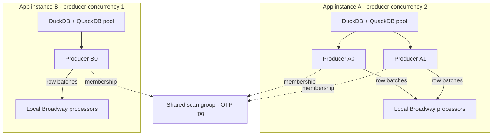
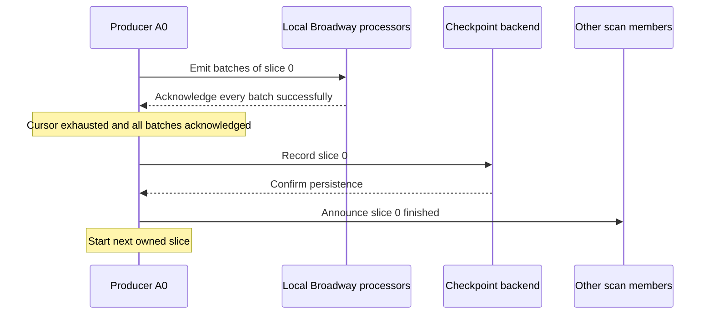

# How producers share a scan

Every scan uses the same execution model: plan a fixed snapshot into slices of whole
data files, join the producers reading that plan, and read the slices this producer owns.
A single producer owns every slice. More producers share the work, whether they run in
the same Broadway pipeline or on other connected Erlang nodes.

This guide follows a pipeline named `MyApp.Backfill`, running on two app instances:
node A has producer concurrency 2 and node B has producer concurrency 1. All three
producers read the same table and snapshot.

For Iceberg snapshots, manifests, and DuckDB's role, see
[How Iceberg and DuckDB work here](iceberg-and-duckdb.md). The exact options and telemetry
contracts are in `OffBroadway.Iceberg.Producer`.

## Producers, app instances, and DuckDB

Broadway's producer concurrency counts producer processes **on that node**. Each process
is a member of the shared scan. The number of members is the sum of producer concurrency
across the app instances participating in that scan:

| App instances | Producers per instance | Members |
| --- | --- | --- |
| 1 | 4 | 4 |
| 4 | 1 | 4 |
| 2 | 2 | 4 |
| 2 | 2 on A, 1 on B | 3 |

The assignment and completion rules are the same in all four cases. Throughput and
failure isolation differ: local producers share the resources of their app instance,
while another instance can have its own DuckDB, connection pool, and processors.



`:pg` provides membership and change notifications. Members send finished-slice
announcements directly to their peers. Each producer fetches
rows through its configured QuackDB pool and sends them to its local Broadway processors.
The scan coordinator does not forward row batches between app instances.

Each producer holds one connection while reading its current slice. Size a local pool
for its concurrent producer stages, with capacity for other database work if needed.
DuckDB threads and memory are separate settings; adding producer processes does not
give a shared DuckDB instance more CPU or memory.

## Selecting one snapshot

Every member must read the same fixed snapshot. Configure either an integer snapshot id
or a fixed `{:as_of, datetime}`:

```elixir
producer: [
  module:
    {OffBroadway.Iceberg.Producer,
     connection: MyApp.QuackDB,
     table: "lake.betting.events",
     snapshot_id: {:as_of, ~U[2026-11-12 00:00:00Z]},
     slice_rows: 1_000_000},
  concurrency: 2
]
```

Use the same snapshot value on node B, even if its concurrency is 1. `:current` is
rejected because two producers resolving it at different times could choose different
snapshots. Likewise, computing `DateTime.utc_now()` independently in each app instance
does not give the job a shared cutoff. Choose the value once in job configuration.

An as-of timestamp resolves through the table's history of which snapshot was current
when, including rollbacks. Retain that history and the chosen snapshot for the life of
the job. A timestamp before the first snapshot produces an empty scan.

## Planning slices

Each producer independently asks the snapshot's manifests for its live data files and
their record counts. It orders the files by path, then groups consecutive files until
their combined record count reaches `:slice_rows`, which defaults to `1_000_000`.
The last slice may be smaller. A file is never split, even when it exceeds the target.

With eight files of 500,000 rows each, the default target makes four slices:

| Slice | Files | Rows before filtering and deletes |
| --- | --- | ---: |
| 0 | F0, F1 | 1,000,000 |
| 1 | F2, F3 | 1,000,000 |
| 2 | F4, F5 | 1,000,000 |
| 3 | F6, F7 | 1,000,000 |

All members compute the same ordered plan. A SHA-256 fingerprint covers its file paths,
slice boundaries, selected columns, and formatted `:where` condition. Members exchange
slice indexes, so agreeing on the plan is essential: slice 2 must mean the same files
everywhere.

`:slice_rows` is a planning target. `:fetch_size` bounds the rows in each Broadway
message, and Broadway demand controls how many messages are fetched. A million-row
slice is streamed in batches rather than held in memory. A selective `:where` or delete
files can leave a slice with far fewer visible rows, including none.

Each slice is read through the pinned Iceberg table, filtered by its data-file paths:

```sql
SELECT * FROM lake.betting.events AT (VERSION => 123456789)
WHERE filename IN ('path/to/F4.parquet', 'path/to/F5.parquet');
```

DuckDB still applies Iceberg deletes. Physical columns named `filename`, regardless of
case, are rejected during planning because they would hide the virtual column used for
this filter. A projection that omits the conflicting column does not make it safe.

## Finding the other producers with :pg

The application starts an OTP `:pg` scope on each node. Once a producer has planned its
scan and loaded any checkpoints, it joins a group and monitors membership changes.

Without checkpoints, a group is identified by:

- The Broadway pipeline name, such as `MyApp.Backfill`.
- The table's name parts.
- The resolved snapshot id.
- The plan fingerprint.

With checkpoints, the backend module, storage namespace, and job id replace the pipeline
name. For GCS, the storage namespace is the endpoint, bucket, and prefix. This lets
pipelines with different names cooperate on one persisted job, while keeping different
checkpoint stores separate.

The connection pool name, producer index, and producer concurrency are not part of the
group identity. A0 and A1 therefore join the same group as B0, despite their different
local stage indexes and pool processes. Table aliases do matter: use the same `:table`
name on every instance, even if different names resolve to the same underlying table.

`:pg` tracks processes on connected Erlang nodes. It does not discover pods or establish
the Erlang cluster. Configure node connectivity with your application's clustering
setup, such as DNSCluster or libcluster. An isolated app instance sees only its local
members and scans the whole plan between them. Sharing a checkpoint bucket alone does
not provide live membership or exclusive ownership.

## Assigning and reading slices

For each unfinished slice, every member computes a score for each current member using
rendezvous hashing. The highest-scoring PID owns the slice. Once members agree on the
membership list, they agree on ownership without asking a leader to assign work.

An illustrative assignment for our three producers is:

| Producer | Owned slices |
| --- | --- |
| A0 | 0, 3 |
| A1 | 1 |
| B0 | 2 |

The actual assignment depends on the PIDs. It is not round-robin, and members are not
guaranteed equal amounts of work. Each producer reads one slice at a time. There cannot
be more useful concurrent readers than slices; a table stored in one large file has
only one slice, whatever the producer concurrency.

When a member joins, rendezvous hashing moves only the slices it wins. When one leaves,
only the slices it owned need new owners. A departing app instance removes all its
producer members.

Membership changes are asynchronous. A producer keeps reading a slice it has started,
even if a new member becomes its owner. It stops that read when it hears that another
member finished the slice, subject to the checkpoint rules below. Batches already sent
to Broadway still have to be acknowledged. This can produce duplicate processing during
startup, scaling, restarts, or network partitions. Downstream writes must be idempotent.

## Acknowledgements, progress, and checkpoints

A slice has finished when its cursor reached the end and every emitted batch was
acknowledged. Members announce finished slices to their peers, and existing members
send their accumulated progress to newcomers. Progress includes the slice's row, batch,
and failed-batch counts. If a slice was read more than once, merging keeps the result
with the fewest failed batches, with deterministic tie-breaking.

Without checkpoints, failed batches still count as acknowledged and finish a slice for
that run. They are logged and counted, with no automatic retry.

With checkpoints, a successful slice follows this order:



Each checkpointed producer waits for its current slice's acknowledgements and persistence
before starting another. That bounds checkpoint writes to one per producer; other members
can still read and record their own slices concurrently. A slow backend applies
backpressure rather than building an unbounded write queue.

A slice with failed batches is announced as finished for the current run but is not
checkpointed. Active copies on other members can continue and record a successful copy.
To retry slices that remain unrecorded, start the job again after all its old members
have stopped. Members left running remember those failed slices as finished for that run.

If a producer crashes after downstream processing but before a confirmed checkpoint,
the slice can be replayed. A checkpoint makes progress durable; it does not make
downstream processing exactly once.

## Completion and failures

Each producer emits its own `[:off_broadway_iceberg, :scan, :stop]` event once it knows
every slice is finished, its own messages are acknowledged, and its own checkpoint writes
have returned. A late-joining producer can learn that all slices are finished and emit
`:stop` without reading a row.

The event's `:rows`, `:batches`, and `:failed_batches` cover the whole scan, counting one
copy of each slice. Do not sum those totals across producers. `:local_failed_batches`
counts failures in every batch this producer emitted, including duplicate copies whose
failures were excluded from the whole-scan result.

`failed_batches: 0` means every slice has a successfully processed copy. It does not mean
each row was processed only once, or that all the other producers have stopped. The
producer remains idle after completion; see the producer reference for stopping Broadway
from a telemetry handler.

When a producer cannot plan or read a slice, or cannot load or write a checkpoint, it
emits `:exception`, leaves the group, and stays idle. Surviving members take over its
unfinished slices. A whole-node failure has the same effect for all its members. An
interrupted slice is read again from its beginning, rather than resumed at a row offset.

During a network partition, each side can assign and process the same unfinished
slices. On reconnection, membership and progress converge; duplicate downstream effects
still need idempotent handling. With no checkpoints, stopping every member loses the
in-memory progress. With checkpoints, the next run loads the recorded slices and only
reads the rest.
