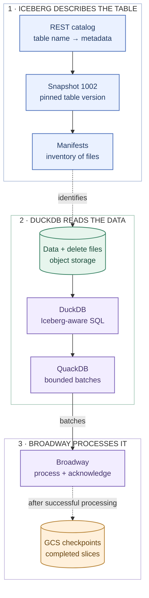
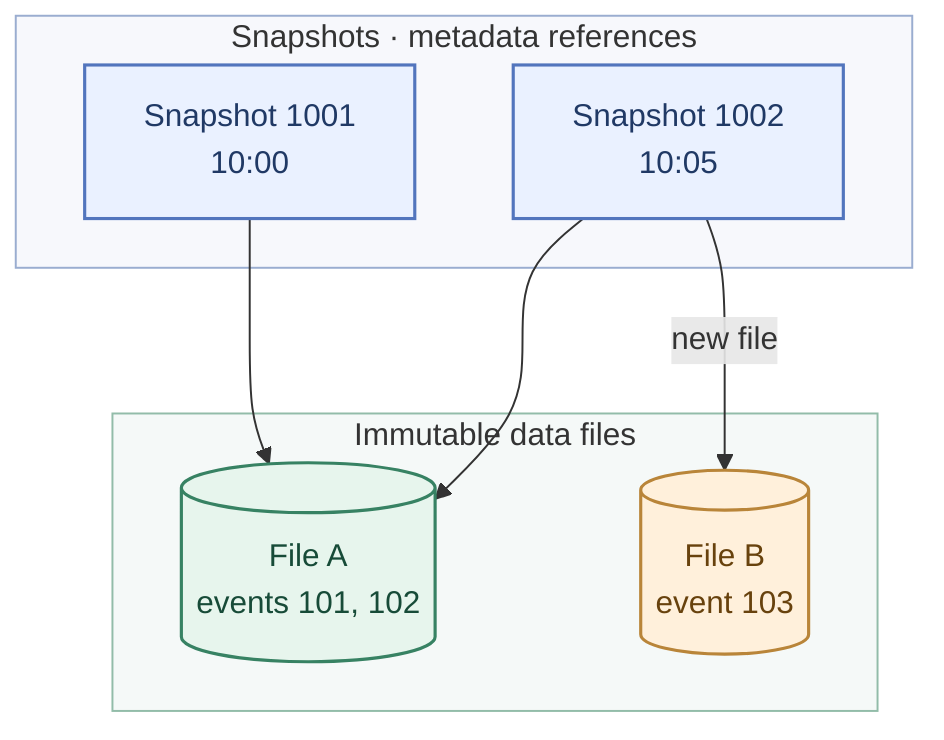
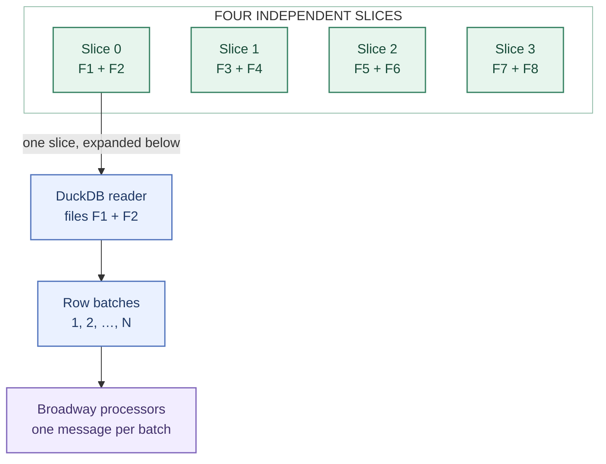
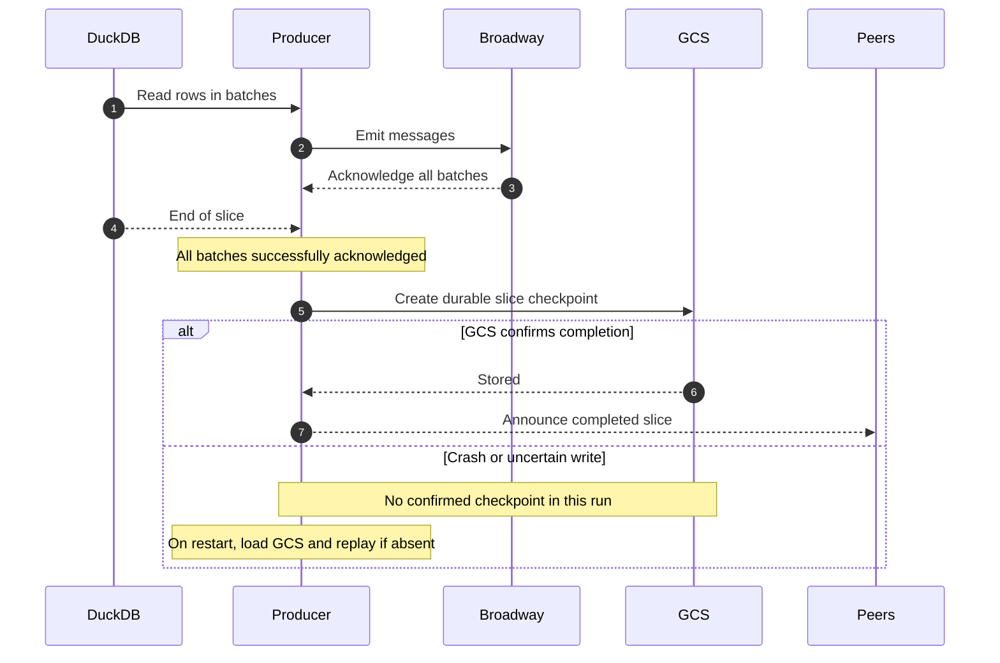
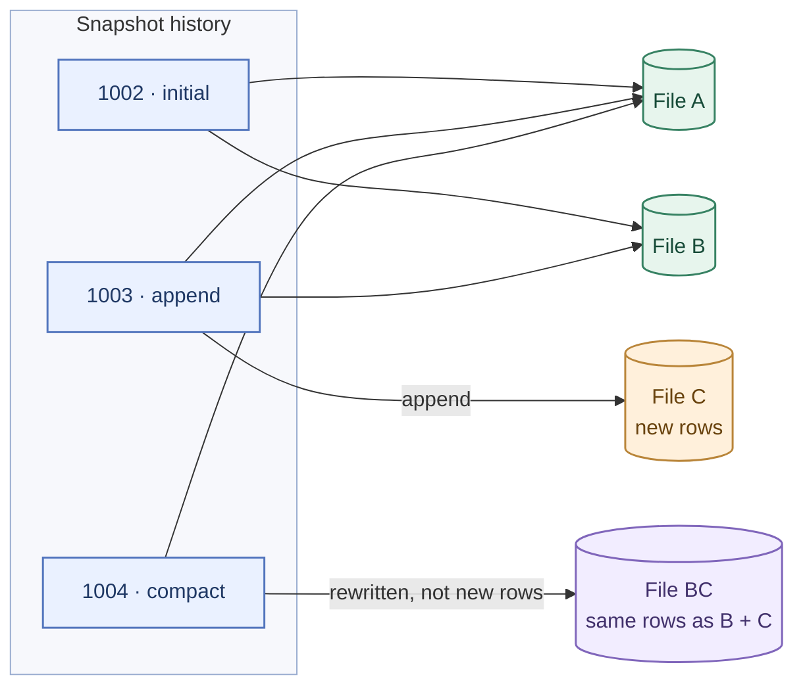

# How Iceberg and DuckDB work here

This guide explains the parts of [Apache Iceberg](https://iceberg.apache.org/) and
[DuckDB](https://duckdb.org/) that `off_broadway_iceberg` is built on, and how each one
shapes the library. It is written for developers who know Elixir and Broadway but have not
worked with Iceberg or DuckDB, and it takes about 15 minutes to read.

It is not a tutorial on either technology. It covers just enough of each to explain why
the library works the way it does, and links to the official documentation wherever a
topic goes deeper. For the exact behavior of every option, see
`OffBroadway.Iceberg.Producer`.

We'll follow one small, fictional `lake.betting.events` table throughout the guide.
It starts with two events:

| event_id | player_id | amount |
| --- | --- | ---: |
| 101 | alice | 20 |
| 102 | bob | 150 |

The next commit appends event 103 (`alice`, amount 75); a later one deletes event
102. These three rows will help us distinguish *files on disk*, *rows visible in a
snapshot*, and *batches delivered to Broadway*. [Try it yourself](#try-it-yourself)
uses a real public catalog instead.

## The whole picture



Read this as a map of responsibilities, **not a pipe through which every row travels**.
The catalog and manifests describe what belongs to the table; DuckDB reads the files
directly from storage. Checkpoints separately record Broadway's progress, rather
than storing another copy of the data.

## What the library does

A backfill processes a table as it was at one point in time: it loads a year of events
into a new store, recomputes an aggregate, or rebuilds a search index. The table can hold
billions of rows, far more than fit in memory, so the rows must arrive a batch at a time,
at the pace the pipeline can take them.

[Broadway](https://hexdocs.pm/broadway/Broadway.html) sets that pace. Its processors ask
the producer for messages, which GenStage calls
[demand](https://hexdocs.pm/gen_stage/GenStage.html), and the producer only fetches as
many batches as were asked for. `OffBroadway.Iceberg.Producer` is that producer: each
message it emits is one batch of rows of one Iceberg snapshot, read through DuckDB.

Two things make this harder than reading a big file:

- The table keeps changing while the backfill runs.
- One machine may not be enough, and several must share the work without skipping rows.

Iceberg's snapshots answer the first, and the shape of its metadata makes the second
possible.

## An Iceberg table is metadata plus files

An Iceberg table is neither a server nor a single file. It is a set of data files, plus
metadata files that say which data files make up the table. Data files aren't edited in place: a commit adds or replaces files, then publishes
new metadata pointing to them. Maintenance can later delete old files when no
retained snapshot needs them.

### Data files

Rows live in data files, usually [Apache Parquet](https://parquet.apache.org/docs/overview/)
files. Parquet stores each column separately, in large groups of rows called
[row groups](https://parquet.apache.org/docs/concepts/), and keeps statistics, such as
each column's minimum and maximum, for every row group. A reader that needs two columns out of twenty can avoid reading the other columns.
For `amount > 100`, it **may** skip row groups whose statistics prove they hold no
matches. How much can be skipped depends on the data and the predicate. That matters
in [Selecting columns and rows](#selecting-columns-and-rows).

A data file is the smallest piece of work this library hands out. One file can hold ten
rows or fifty million.

### Metadata

- The **catalog** maps a table's name to its current metadata file. A commit swaps that
  pointer in one atomic step, so readers see either the old table or the new one. This
  library reads tables of a catalog DuckDB attaches, usually an
  [Iceberg REST catalog](https://iceberg.apache.org/rest-catalog-spec/).
- The **metadata file** holds the schema, the partitioning, every snapshot the table
  keeps, and refs, the named pointers to snapshots such as the `main` branch.
- A **snapshot** is the table as one commit left it. It points at a **manifest list**,
  which lists **manifests**. Manifest entries describe data and delete files and can
  include file-level row counts and column statistics. Parquet row groups have their
  *own* statistics, used later while DuckDB reads the file.

The catalog only holds pointers. The data files live in object storage, such as S3 or
GCS, and DuckDB reads them from there itself.

Read more: the [Iceberg terms](https://iceberg.apache.org/terms/), and the spec's
[overview](https://iceberg.apache.org/spec/#overview),
[table metadata](https://iceberg.apache.org/spec/#table-metadata),
[manifests](https://iceberg.apache.org/spec/#manifests) and
[manifest lists](https://iceberg.apache.org/spec/#manifest-lists).

## Snapshots: the table at one point in time

Each successful table change creates a new snapshot. Imagine the small events table
is held in two Parquet files:



Snapshot 1001 shows events 101 and 102. Snapshot 1002 shows all three.
Both snapshots point to **the same physical File A**; Iceberg did not copy it.

A snapshot is an inventory of files, not a copy of the table. Because its data files
are immutable, snapshot 1001 can still be read after 1002 and 1003 are committed. That lasts until a maintenance job
[expires](https://iceberg.apache.org/docs/latest/maintenance/) old snapshots, and deletes
the files that no remaining snapshot needs.

DuckDB reads one snapshot with
[time travel](https://duckdb.org/docs/2.0/core_extensions/iceberg/overview#catalog-managed-tables):

```sql
SELECT * FROM lake.betting.events AT (VERSION => 1002);
```

The producer reads every row this way. Before it reads any, it resolves `:snapshot_id` to
one snapshot:

- `:current` is the snapshot the `main` branch points at, from `iceberg_refs`.
- An integer is that snapshot.
- `{:as_of, datetime}` is the snapshot that was current at that time, from
  `iceberg_history`, the log of which snapshot was current when.

Pinning one snapshot is what lets several producers share a scan, and a scan resume.
Suppose producer A planned the scan at snapshot 1002 and producer B at 1003. B would see
`events-c.parquet`, which A knows nothing of, and they could not agree on which rows are
left. That is why a distributed scan refuses `:current`: two nodes that resolve "current"
a minute apart can get different snapshots.

The other side of pinning: a pinned snapshot can be expired. A scan of a snapshot that
was expired fails. It never reads another snapshot instead.

Read more: the spec's [snapshots](https://iceberg.apache.org/spec/#snapshots) and
[snapshot references](https://iceberg.apache.org/spec/#snapshot-references), and
[branching and tagging](https://iceberg.apache.org/docs/latest/branching/).

## Delete files: why every read goes through Iceberg

Iceberg can delete rows without rewriting data files. A commit adds **delete files**
that say which rows of which data files are gone: by position (the third row of
`events-a.parquet`), by value (every row whose `id` is 42), or, in format version 3, as
deletion vectors. Readers apply them as they read.

Suppose snapshot 1003 deletes event 102. File A may still physically contain that
row, but an Iceberg-aware query over snapshot 1003 must return only events 101 and
103. The visible rows of a snapshot aren't always the raw rows of its data files.
Reading File A directly with DuckDB's `read_parquet` could incorrectly return 102.

That is why this library never reads a data file by itself, even though it knows every
path. Every read is a query on the Iceberg table, and DuckDB applies the delete files.
When a distributed scan reads only some of the files, it names them with DuckDB's
`filename` column:

```sql
SELECT * FROM lake.betting.events AT (VERSION => 1002)
WHERE filename IN ('s3://lake/betting/events/data/events-b.parquet');
```

DuckDB opens only that file, and still applies the deletes that refer to it. The
integration tests cover the deletes DuckDB itself writes, which are position deletes.

Read more: the spec's [row-level deletes](https://iceberg.apache.org/spec/#row-level-deletes).

## DuckDB and QuackDB

DuckDB is a SQL engine for analytics. It processes data in
[vectors](https://duckdb.org/docs/2.0/internals/vector) of 2,048 values at a time, and its
[iceberg extension](https://duckdb.org/docs/2.0/core_extensions/iceberg/overview) can
[attach a catalog](https://duckdb.org/docs/2.0/core_extensions/iceberg/catalogs) and query
its tables like any other, with [metadata functions](https://duckdb.org/docs/2.0/core_extensions/iceberg/iceberg_functions)
such as `iceberg_snapshots` and `iceberg_files` besides.

DuckDB usually runs inside the program that uses it. Here it runs as a server of its own:
a separate OS process that answers queries over HTTP, with DuckDB's
[Quack protocol](https://duckdb.org/docs/2.0/quack/overview).
[QuackDB](https://hexdocs.pm/quackdb) is the Elixir client, and with `duckdb: :managed`,
`QuackDB.Server` downloads the DuckDB binary and runs it under your supervision tree. That
explains several things in the library:

- Extensions and attached catalogs belong to the DuckDB server, not to one connection.
  That is why the README attaches the catalog before the pipeline starts, and gives each
  pipeline a DuckDB of its own.
- A query's results come back in chunks, one round trip at a time. One process per
  producer holds a connection and its cursor for the whole read, and fetches a batch only
  once Broadway has asked for one, so backpressure reaches DuckDB.
- Each batch arrives as a `QuackDB.Columns`: decoded Elixir values, one list per column,
  with at most `:fetch_size` rows.
- The protocol has no server-side parameters, so QuackDB writes params into the SQL as
  literals, on the client. `:where` relies on that.

## Files and rows: sharing a scan

Imagine eight Parquet files and four workers. We want each worker to have useful
work without forcing it to read the entire table.

The library works with **two different units**:

- **Slices group whole data files.** A producer owns a slice, and a file isn't
  intentionally split between slices.
- **Broadway messages contain batches of rows.** DuckDB streams a slice's rows
  in batches of up to `:fetch_size` rows.



The diagram expands **only Slice 0**. Slices 1–3 can be read independently by other
producers using the same procedure. A slice can contain millions of rows without
holding them all in BEAM memory: the producer waits for Broadway demand before
fetching another batch.

Planning reads only metadata. It asks the snapshot's manifests for its data files and
their row counts, without opening any of them:

```sql
SELECT file_path, record_count
FROM iceberg_files('lake.betting.events', snapshot_from_id => 1002)
WHERE content = 0 -- data files; delete files are 1 and 2
ORDER BY file_path;
```

Consecutive small files make one slice once they hold `:slice_rows` rows between them,
a million by default, and a larger file makes a slice of its own. Files are never split.
With 8 data files of 500,000 rows each, the scan has 4 slices of 2 files, and with a
`:fetch_size` of 10,000, each slice makes 100 messages. A table stored in one huge file
makes one slice, which only one producer can read.

Every producer plans on its own. Since they all plan the same snapshot the same way, they
all get the same slices, in the same order, so a slice is known by its position. A
SHA-256 fingerprint of the plan, which covers the slices and what the scan selects from
them, shows that two producers really planned the same scan. Only producers with the same
fingerprint share a scan.

Producers find each other with OTP's [`:pg`](https://www.erlang.org/doc/apps/kernel/pg.html)
process groups, across connected nodes. Each slice belongs to the member that wins
[rendezvous hashing](https://en.wikipedia.org/wiki/Rendezvous_hashing) for it: every member
works out the same owner without asking the others, and when a member joins or leaves,
only its slices move. A member that finishes a slice tells the others, and the members
tell any member that joins which slices are finished.

This is at-least-once: while members come and go, a slice can be read twice. "Distributed
scans" in `OffBroadway.Iceberg.Producer` says exactly what the `:stop` event guarantees.

## Selecting columns and rows

Two different things decide what a scan reads, and they are easy to confuse:

- **Iceberg metadata describes files**: which data files a snapshot has, their row
  counts, and statistics for each column. It is written once, at commit time.
- **DuckDB's query plan describes one query**: which columns to read, which conditions
  to apply, and where. DuckDB's optimizer pushes the columns and conditions it can down
  into its Iceberg scan, which can then skip
  [the parts of Parquet files](https://duckdb.org/docs/2.0/data/parquet/overview#partial-reading)
  whose statistics rule a condition out.

`:columns` and `:where` work through the query plan. A slice of a scan with both runs:

```sql
SELECT "event_id", "amount"
FROM (SELECT * FROM lake.betting.events AT (VERSION => 1002) WHERE filename IN (...))
WHERE (
amount > 100
)
```

DuckDB pushes both the columns and the condition into its Iceberg scan, which
[`EXPLAIN`](https://duckdb.org/docs/2.0/guides/meta/explain) shows (see
[Try it yourself](#try-it-yourself)). The file filter stays in the inner query, so the
condition cannot change which files a slice reads.

For our little example, `where: {"amount > ?", [100]}` selects only event 102 in
snapshot 1002. Selecting `columns: ["event_id", "amount"]` would deliver those
two columns, not `player_id`.

The predicate does **not** yet shape the *slice plan*: every data file is considered
during planning, even when a slice will produce no matching rows. DuckDB may still
skip physical reads when the predicate and statistics allow it. Pruning irrelevant
files *during planning* would be a separate improvement.

> #### The condition must not change {: .warning}
>
> The plan's fingerprint covers the text of `:where`, not the rows it selects. A
> condition such as `occurred_at < now()` selects different rows on different nodes and
> runs, and producers cannot tell. Pass fixed values as params instead. See "Selecting
> columns and rows" in `OffBroadway.Iceberg.Producer`.

## Checkpoints: a checklist outside the cluster

Without checkpoints, what the members of a scan know lives only in their memory. If every
node stops at once, as in a full redeploy, the next run starts from the beginning. With
idempotent writes, that is harmless, but a long backfill loses its progress.

A checkpoint backend writes the progress down. With `OffBroadway.Iceberg.Checkpoint.GCS`,
object storage plays two roles that have nothing to do with each other:

- The table's files may live in S3, GCS or anywhere else DuckDB can read. They are what
  the scan reads.
- Checkpoints live in a GCS bucket of their own. They are the library's record of its
  progress. A table stored in S3 can be checkpointed in GCS.

A job is one scan of one snapshot, named by `:job_id`. Its first run records the job: its
table, snapshot, plan fingerprint and number of slices. Then each slice whose batches all
succeeded is recorded as a small object of its own:

```text
gs://my-checkpoints/iceberg/jobs/events-backfill-2026-11/job.json
gs://my-checkpoints/iceberg/jobs/events-backfill-2026-11/slices/000000.json
gs://my-checkpoints/iceberg/jobs/events-backfill-2026-11/slices/000003.json
```

The crucial ordering is **acknowledge first, persist second, announce third**:



If the producer crashes after processing rows but before GCS confirms the
checkpoint, the next run may replay the slice. That is why downstream writes
must be idempotent. Failed batches never produce successful checkpoints.

Every object is created with a
[precondition](https://cloud.google.com/storage/docs/request-preconditions),
`ifGenerationMatch=0`, which means "only if it does not exist yet". Producers on several
nodes can record the same slice at the same time, and none overwrites another. A later run
of the job loads the recorded slices, and reads only the others.

Checkpoints let a restart skip finished work. They do not make processing exactly-once: a
producer can process every batch of a slice and stop before recording it.

Read more: "Checkpoints" in `OffBroadway.Iceberg.Producer`, and
`OffBroadway.Iceberg.Checkpoint.GCS` for the bucket layout, permissions and
authentication.

## What a snapshot scan is not

A scan reads the rows of one snapshot. It does not tell what changed between two
snapshots, and it is not a stream of changes.

New files between two snapshots are not the same as new rows:



Between 1003 and 1004, a new file appeared, but no row is new: reading "the files added since
1003" would deliver the rows of `events-b` and `events-c` again. Iceberg records what each
commit did, in the `operation` of its snapshot: `append`, `replace`, `overwrite` or
`delete`. Telling new rows apart starts there, and the library does not do it yet. To
process data committed later, scan a later snapshot, with writes that are idempotent.

Idempotent writes are a requirement throughout: a pipeline started again after a failure
reads the snapshot again, unless it is checkpointed, a slice can be read twice, and a
checkpoint can miss a slice that was processed. Key writes by the snapshot and the row's
own key, so a replay is harmless.

Read more: the spec's [snapshots](https://iceberg.apache.org/spec/#snapshots), whose
summary records the operation, and [sequence numbers](https://iceberg.apache.org/spec/#sequence-numbers).

## Try it yourself

[LakehouseBox](https://lakehousebox.com/docs/sample-data/) runs a public Iceberg REST
catalog that anyone can read, the one the examples use. With the
[DuckDB 2.0 command line](https://duckdb.org/docs/2.0/core_extensions/iceberg/overview),
attach it:

```sql
INSTALL iceberg; LOAD iceberg;
INSTALL httpfs; LOAD httpfs;

ATTACH 'commons/pubdata' AS pubdata
  (TYPE iceberg, URI 'https://public-catalog.lakehousebox.com', AUTHORIZATION_TYPE 'none');
```

First, inspect the snapshot history. Observe the `snapshot_id` and `operation`
columns: they reveal which table versions exist and what kind of change created
each one. The public table changes over time, so your results may differ:

```sql
SELECT snapshot_id, parent_id, operation, timestamp_ms
FROM iceberg_snapshots('pubdata.environment.earthquakes')
ORDER BY sequence_number;

SELECT name, snapshot_id FROM iceberg_refs('pubdata.environment.earthquakes');
```

Next, inspect the file inventory that the library uses to plan slices. For the
second query, replace the illustrative `1002` with a real, retained snapshot ID
from your first query:

```sql
SELECT file_path, record_count
FROM iceberg_files('pubdata.environment.earthquakes')
WHERE content = 0;

SELECT file_path, record_count
FROM iceberg_files('pubdata.environment.earthquakes', snapshot_from_id => 1002)
WHERE content = 0;
```

Then compare the current table with that earlier snapshot (again, replace `1002`).
Counts may differ after appends or deletes, but compaction can replace files
without changing the row count:

```sql
SELECT count(*) FROM pubdata.environment.earthquakes;
SELECT count(*) FROM pubdata.environment.earthquakes AT (VERSION => 1002);
```

Finally, inspect the query plan. Look for `ICEBERG_SCAN`: its projections should
contain only `magnitude` and `event_time`, and its filter should contain
`magnitude >= 7.5`:

```sql
EXPLAIN
SELECT event_time, magnitude
FROM pubdata.environment.earthquakes
WHERE magnitude >= 7.5;
```

Then run [`examples/public_catalog.exs`](https://github.com/efcasado/off_broadway_iceberg/blob/main/examples/public_catalog.exs)
to read the same table through the producer. LakehouseBox is run by a third party, so its
tables and snapshots may change, or go away.

## Where to find it in the code

| Concept | Where |
| ------- | ----- |
| Options, demand, acknowledgements, `:stop`, the checkpoint flow | [`lib/off_broadway/iceberg/producer.ex`](https://github.com/efcasado/off_broadway_iceberg/blob/main/lib/off_broadway/iceberg/producer.ex) |
| Resolving the snapshot, planning slices, the SQL, owning the cursor | [`lib/off_broadway/iceberg/scan.ex`](https://github.com/efcasado/off_broadway_iceberg/blob/main/lib/off_broadway/iceberg/scan.ex) |
| `:pg` groups, rendezvous hashing, plan fingerprints, finished slices | [`lib/off_broadway/iceberg/distribution.ex`](https://github.com/efcasado/off_broadway_iceberg/blob/main/lib/off_broadway/iceberg/distribution.ex) |
| The checkpoint behaviour | [`lib/off_broadway/iceberg/checkpoint.ex`](https://github.com/efcasado/off_broadway_iceberg/blob/main/lib/off_broadway/iceberg/checkpoint.ex) |
| The GCS backend | [`lib/off_broadway/iceberg/checkpoint/gcs.ex`](https://github.com/efcasado/off_broadway_iceberg/blob/main/lib/off_broadway/iceberg/checkpoint/gcs.ex) |
| A fake DuckDB, an in-memory checkpoint backend and a fake GCS, for unit tests | [`test/support/`](https://github.com/efcasado/off_broadway_iceberg/tree/main/test/support) |
| The Iceberg REST catalog and GCS emulator of the integration tests | [`docker-compose.yml`](https://github.com/efcasado/off_broadway_iceberg/blob/main/docker-compose.yml), [`test/support/iceberg.ex`](https://github.com/efcasado/off_broadway_iceberg/blob/main/test/support/iceberg.ex) |

`Scan` and `Distribution` are internal, so they have no pages in these docs. Their
modules start with comments that explain their part.
